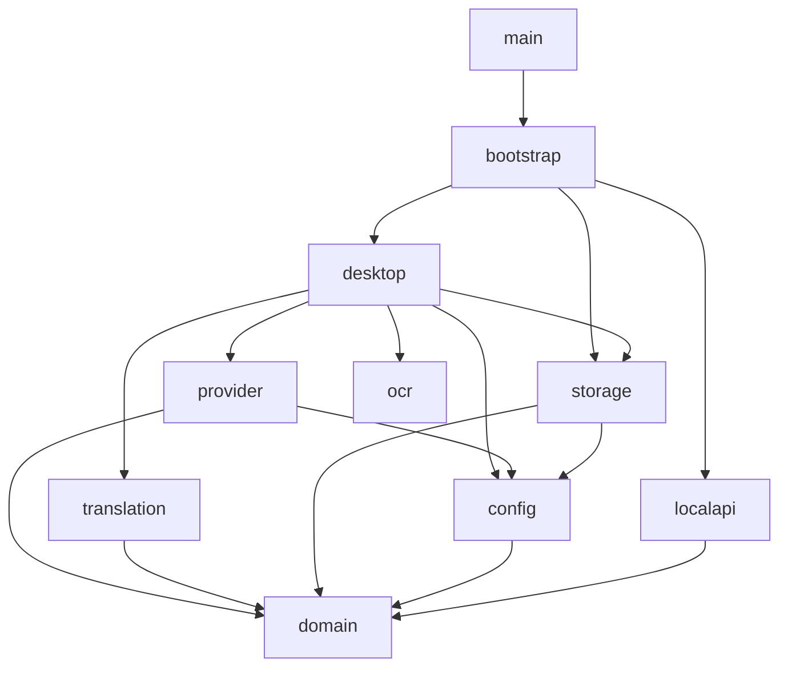

# 架构与目录职责

## 设计边界

Lumin 是单进程原生桌面应用。UI 只负责交互与展示；翻译协议、任务调度、存储和 OCR 分别维护。优先使用 Go 标准库，除 MyGo 外没有引入应用层框架、ORM 或数据库驱动。

```text
Lumin/
├── main.go                     # 嵌入应用图标并启动，保留 MyGo 默认入口约定
├── mygo.json                   # 应用标识、版本与原生打包配置
├── go.mod / go.sum             # 固定框架与依赖版本
├── internal/
│   ├── bootstrap/run.go        # 依赖组装、窗口、单实例、托盘、快捷键、退出
│   ├── domain/translation.go   # 请求、结果、语言、历史、Translator 接口
│   ├── config/                # 配置 v1、默认值、校验及深拷贝
│   ├── translation/           # 并行调度、结果排序、取消传播
│   ├── provider/              # HTTP 翻译协议适配
│   ├── storage/               # JSON 持久化、原子替换、历史与收藏
│   ├── ocr/                   # Recognizer 接口、Tesseract 子进程
│   ├── localapi/              # 外部调用 HTTP handler，不依赖 MyGo
│   └── desktop/
│       ├── app.go             # 主线程状态、后台任务、动作
│       ├── view.go            # MyGo 原生视图
│       └── app_test.go        # 交互、异步生命周期、布局渲染测试
├── resources/icon.png         # 应用图标
├── docs/                      # 维护文档
├── Makefile                   # 常用检查与构建命令
└── pot-desktop-3.0.7/          # 原始参考，保持独立，不参与新应用构建
```

根入口保持很薄，而不是为了形式增加 `cmd/lumin`；MyGo 的默认开发和打包命令直接构建根目录。未来增加 CLI、后台服务等第二个可执行程序时，再新增 `cmd/<name>` 并调整构建配置。

## 依赖方向



`domain` 不依赖框架、文件系统或 HTTP。`Translator` 是翻译能力的最小接口，`Recognizer` 是 OCR 能力的最小接口。没有建立通用 `utils`、全局服务定位器或空接口堆积；新增能力应放在有明确职责的包内。

`desktop.Ports` 注入事件分发、剪贴板、文件选择器和桌面设置回调。生产环境通过 `Window.Update` 分发，测试通过函数队列模拟，因此不需要在单元测试中打开真实窗口或连接翻译 API。

## 一次翻译的生命周期

1. 输入动作生成不可变 `domain.Request` 和配置快照。
2. 主线程取消上一任务，并增加 `generation`。
3. `translation.Run` 在后台调用已启用的服务，最多同时运行 4 个。
4. 每个服务返回独立结果；回调串行发出，通过 `Window.Update` 发布到 UI。
5. UI 只接受当前 `generation` 的结果。编辑原文、切换语言、取消或关闭窗口都会使旧结果失效。
6. 正常完成且允许历史记录时，后台写入历史；然后异步刷新历史列表。服务报错也会记入此次正常完成的记录，整个任务被取消或超时则不保存。

已经完成并开始落盘的历史保存不会因随后编辑文本而撤回。取消保证旧结果不覆盖新 UI，不承诺撤销已经完成的远端请求或历史提交。

UI 状态只在主线程读写。后台工作只能读取启动时的快照，返回后通过 dispatcher 修改状态；`Invalidate` 不是线程同步机制。不要把 `ui.Element` 或 `*ui.Context` 存进状态、后台任务或跨帧回调。使用稳定的 `c.Key`；将涉及列表修改的动作放在 `OnClick` 中。

## 配置与存储

配置必须包含 `version: 1`。未知版本、损坏 JSON 或无效配置会返回明确错误，启动不会覆盖原文件。配置编辑使用深拷贝，保存成功才更新运行配置。

配置和历史均使用同目录临时文件、`Sync`、关闭、`Rename` 的替换方式，避免普通写入中断留下半个 JSON。目录本身未做 fsync，因此不宣称断电事务保证。`Store` 的互斥锁覆盖历史的读改写；跨进程靠应用单实例约束，暂不提供独立多进程存储服务。

普通历史按新到旧保留 `history_limit` 条，收藏不受该上限影响。「清除历史」保留收藏；取消收藏后再清除即可移除。历史目前为 JSON 数组，适合个人使用；大量收藏或全文检索需求出现后，可增加 SQLite repository，再迁移数据，不让数据库逻辑进入视图。

## 平台边界

- MyGo 提供窗口、控件、剪贴板、托盘、快捷键、文件选择和单实例。
- 本版本无自行编写的 Swift/Kotlin/Rust/Zig native module。
- Tesseract 是独立进程，使用参数数组启动，不拼接 shell；90 秒任务上限，图片上限 20 MiB，输出上限 1 MiB。
- HTTP 翻译服务最大响应 2 MiB，不自动重试、不跟随重定向，避免重复计费和密钥转发。错误不记录上游响应体或密钥。
- 外部调用仅绑定回环地址，默认关闭；限 POST、令牌鉴权、限制请求大小与队列长度、拒绝浏览器 Origin。

系统 OCR、截图、划词提取等后续需求通过独立适配包接入；不要在 `view.go` 中放平台分支或系统命令。
