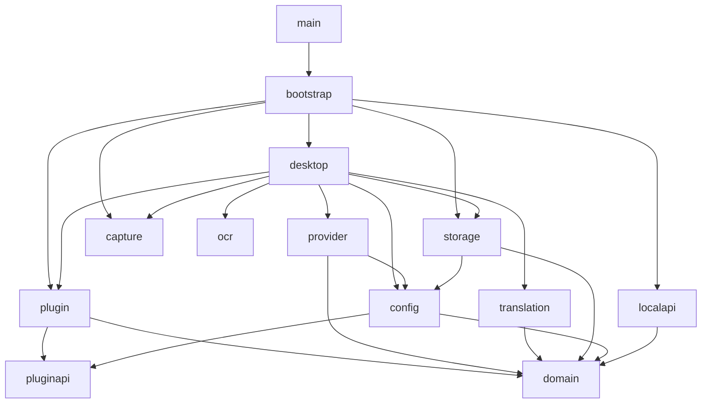

# 架构与目录职责

## 设计边界

Lumin 的主程序是原生桌面应用，OCR 和插件按需启动子进程。UI 只负责交互与展示；翻译协议、任务调度、存储和 OCR 分别维护。优先使用 Go 标准库，除 MyGo 外没有引入应用层框架、ORM 或数据库驱动；Linux 门户通信使用 godbus。

```text
Lumin/
├── main.go                     # 嵌入应用图标并启动，保留 MyGo 默认入口约定
├── mygo.json                   # 应用标识、版本与原生打包配置
├── go.mod / go.sum             # 固定框架与依赖版本
├── internal/
│   ├── bootstrap/run.go        # 依赖组装、窗口、单实例、托盘、快捷键、退出
│   ├── domain/translation.go   # 请求、结果、语言、历史、Translator 接口
│   ├── config/                # 配置 v1、默认值、校验及深拷贝
│   ├── translation/           # 并行调度、结果排序、取消传播
│   ├── provider/              # HTTP 翻译协议适配
│   ├── storage/               # JSON 持久化、原子替换、历史与收藏
│   ├── capture/               # 系统截图、原图坐标换算、裁剪与临时 PNG
│   ├── plugin/                # .luminext 校验、安装、版本管理、进程协议
│   ├── ocr/                   # Recognizer 接口、Tesseract 子进程
│   ├── localapi/              # 外部调用 HTTP handler，不依赖 MyGo
│   └── desktop/
│       ├── app.go             # 主线程状态、后台任务、动作
│       ├── view.go            # 配置主窗口：服务、插件、设置
│       ├── translation_window.go # 独立翻译窗口：输入、结果、历史、收藏
│       ├── selection.go       # 原生截图框选视图
│       ├── providers.go       # 服务构造、独立测试任务、排序/移除
│       ├── preferences.go     # 持久数字/语言编辑器与草稿恢复
│       ├── plugins.go         # 插件管理动作与设置视图
│       └── app_test.go        # 交互、异步生命周期、布局渲染测试
├── pkg/pluginapi/             # 无框架依赖的公开 JSON 协议与 Go SDK
├── cmd/lumin-plugin-pack/      # 插件打包命令
├── plugins/caiyun/            # 维护中的彩云翻译插件（GPL-3.0 移植）
├── examples/plugins/          # 翻译与 OCR 示例
├── scripts/build-plugins.sh    # 示例与正式插件的跨平台构建
├── resources/icon.png         # 应用图标
├── docs/                      # 维护文档
├── Makefile                   # 常用检查与构建命令
└── pot-desktop-3.0.7/          # 原始参考，保持独立，不参与新应用构建
```

根入口保持很薄，而不是为了形式增加 `cmd/lumin`；MyGo 的默认开发和打包命令直接构建根目录。插件打包 CLI 单独位于 `cmd/lumin-plugin-pack`，不改变桌面入口。

## 依赖方向



`domain` 不依赖框架、文件系统或 HTTP。`Translator` 是翻译能力的最小接口，`Recognizer` 是 OCR 能力的最小接口。没有建立通用 `utils`、全局服务定位器或空接口堆积；新增能力应放在有明确职责的包内。

`desktop.Ports` 注入事件分发、剪贴板、文件选择器、截图操作、插件管理器和桌面设置回调。生产环境通过 `Window.Update` 分发，测试通过函数队列模拟，因此不需要在单元测试中打开真实窗口或连接翻译 API。

## 一次翻译的生命周期

1. 输入动作生成不可变 `domain.Request` 和配置快照。
2. 主线程取消上一任务，并增加 `generation`。
3. `translation.Run` 在后台调用已启用的服务，最多同时运行 4 个。
4. 每个服务返回独立结果；回调串行发出，通过 `Window.Update` 发布到 UI。
5. UI 只接受当前 `generation` 的结果。编辑原文、切换语言、取消或关闭翻译窗口都会使旧结果失效。
6. 正常完成且允许历史记录时，后台写入历史；然后异步刷新历史列表。服务报错也会记入此次正常完成的记录，整个任务被取消或超时则不保存。

已经完成并开始落盘的历史保存不会因随后编辑文本而撤回。取消保证旧结果不覆盖新 UI，不承诺撤销已经完成的远端请求或历史提交。

UI 状态只在主线程读写。后台工作只能读取启动时的快照，返回后通过 dispatcher 修改状态；`Invalidate` 不是线程同步机制。不要把 `ui.Element` 或 `*ui.Context` 存进状态、后台任务或跨帧回调。使用稳定的 `c.Key`；将涉及列表修改的动作放在 `OnClick` 中。

## 配置与存储

配置必须包含 `version: 1`。未知版本、损坏 JSON 或无效配置会返回明确错误，启动不会覆盖原文件。配置编辑使用深拷贝，保存成功才更新运行配置。

配置和历史均使用同目录临时文件、`Sync`、关闭、`Rename` 的替换方式，避免普通写入中断留下半个 JSON。目录本身未做 fsync，因此不宣称断电事务保证。`Store` 的互斥锁覆盖历史的读改写；跨进程靠应用单实例约束，暂不提供独立多进程存储服务。

普通历史按新到旧保留 `history_limit` 条，收藏不受该上限影响。「清除历史」保留收藏；取消收藏后再清除即可移除。历史目前为 JSON 数组，适合个人使用；大量收藏或全文检索需求出现后，可增加 SQLite repository，再迁移数据，不让数据库逻辑进入视图。

## 平台边界

- MyGo 提供窗口、控件、剪贴板、托盘、快捷键、文件选择和单实例。
- 本版本无自行编写的 Swift/Kotlin/Rust/Zig native module。
- Tesseract 是独立进程，使用参数数组启动，不拼接 shell；90 秒任务上限，图片上限 20 MiB，输出上限 1 MiB。
- HTTP 翻译服务最大响应 2 MiB，不自动重试、不跟随重定向，避免重复计费和密钥转发。错误不记录上游响应体或密钥。
- 外部调用仅绑定回环地址，默认关闭；限 POST、令牌鉴权、限制请求大小与队列长度、拒绝浏览器 Origin。

截图平台实现已经放在 `capture/screen_<os>.go`，插件进程策略放在 `plugin/process_<os>.go`。新增系统 OCR、划词提取等需求通过独立适配包接入；不要在 `view.go` 中放平台分支或系统命令。

## 截图与插件扩展

截图链路为：后台获取快照 → 主线程全屏框选 → 后台按原图坐标裁剪 → 临时 PNG → 保存配置选中的 Recognizer → 可选翻译。尺寸、权限与窗口生命周期见 [截图文档](screenshots.md)。

插件清单是数据，视图不执行程序。Manager 使用私有暂存目录安装不可变版本；共享读锁覆盖进程运行，卸载等待调用结束。插件实现 Translator / Recognizer 适配器，继续使用现有取消、并发与错误展示机制。配置深拷贝包括每个插件 settings map，避免草稿修改运行参数。插件字段编辑器保存持久字符串，不绑定每帧临时变量。

协议与 SDK 位于 `pkg/pluginapi`，config 只依赖该轻量包校验引用；不依赖进程管理实现，避免循环依赖。详情见 [插件文档](plugins.md)。

服务测试与正式翻译分别使用 probeGeneration / generation，不共用结果数组、历史保存或输入文本。配置草稿快照用于后台调用，主线程完成回调再次比对当前配置；每次只保留一个实例的测试展示，修改后的成功提示视为过期。

## 常驻进程与双窗口（0.4.0）

`bootstrap/run.go` 创建两个保留的原生窗口。`desktop.App.View` 只渲染配置，`TranslationView` 渲染小窗口；两者各有导航字段，共享已保存配置、草稿和结果模型，所有修改仍在主线程。OS 操作通过 Ports 的 ShowPreferences / ShowTranslator / HideTranslator / Quit 接入，不从视图直接访问 MyGo App。

`bootstrap/windows.go` 管理显示、关闭拦截和截图可见性；只依赖最小 residentWindow 接口，可用假窗口测试。普通 OnClose 隐藏并 PreventDefault；翻译窗口额外取消当前请求。OnBeforeQuit 标记 quitting，让所有窗口正常销毁；OnQuit 才关闭 App 状态、取消根 context、释放快捷键/托盘/剪贴板订阅与 HTTP。关闭设置窗口保留草稿和服务测试，关闭翻译窗口不会终止进程。

后台结果仍通过保留的配置窗口 Window.Update 发布，即使该窗口隐藏也会执行，然后 Invalidate 翻译窗口。不要在工作线程写模型、根据可见性跳过回调或在 OnClosed 无条件 App.Quit。截图在主线程记录两个窗口的可见性，临时隐藏，结束后只恢复记录的窗口；quitting 时禁止恢复。单实例重启和 Dock 激活（没有可见窗口且不在截图）打开配置；翻译请求、剪贴板和识别成功只打开翻译窗口。
